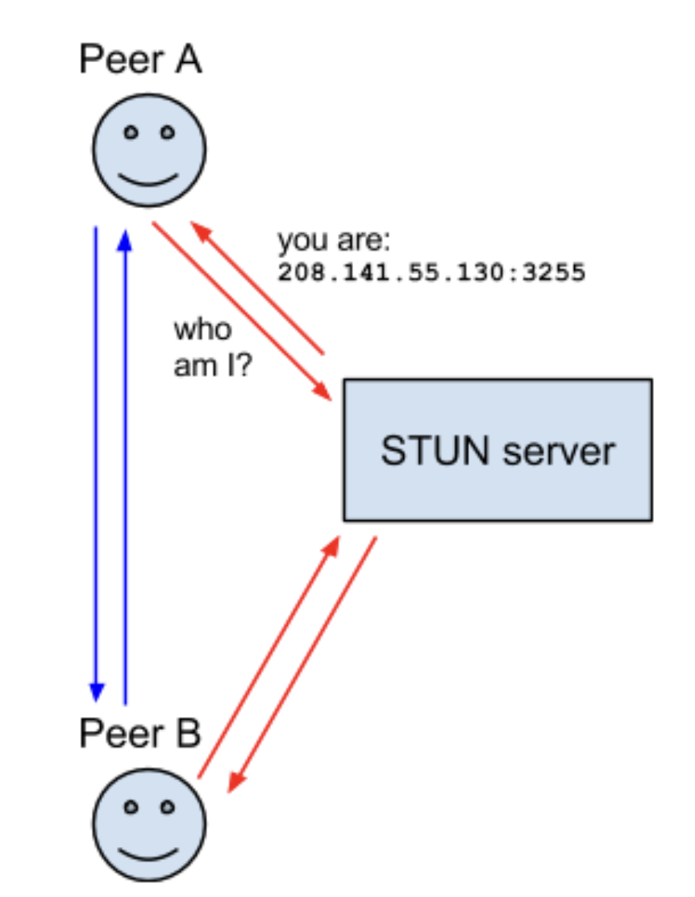
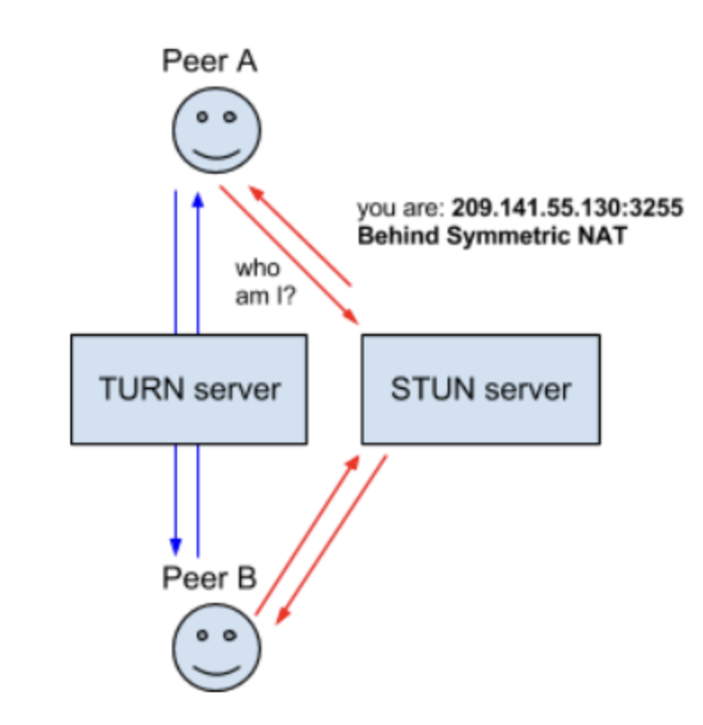
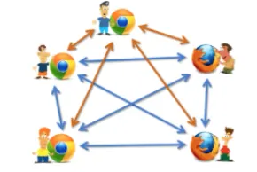
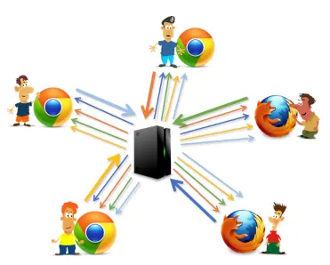
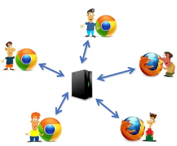
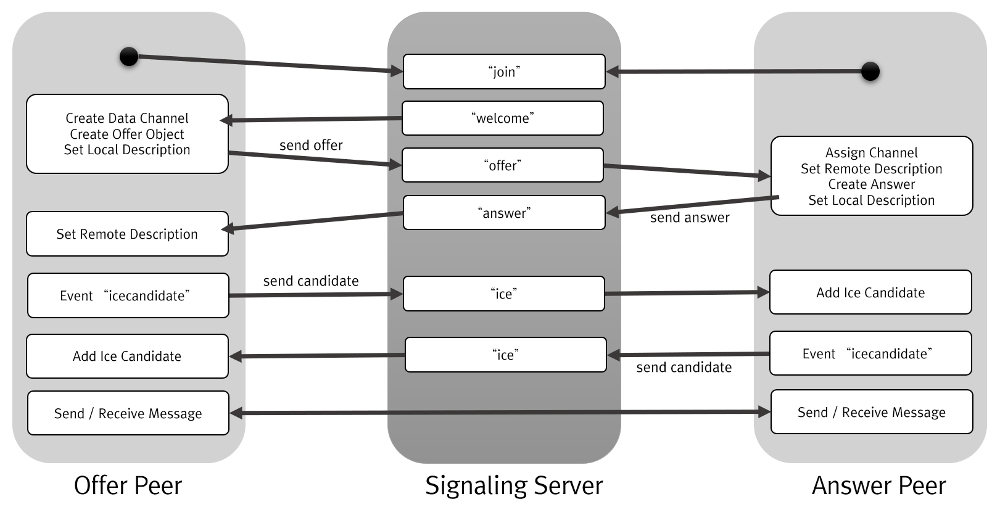

### WebRTC

- 웹/앱에서 별다른 소프트웨어나 플러그인 없이 음성, 영상 미디어, 텍스트, 파일과 같은 데이터를 주고 받을 수 있는 기술
- 주요 용어
    - 시그널링(Signaling) : P2P로 연결하기 위해 중계 서버를 통해 서로를 찾고 연결을 시작하는 과정
    - SDP : 세션 정보, 네트워크 정보, 미디어의 종류, 코덱, 스트림의 속성 등 멀티 미디어 콘텐츠 연결을 설명하기 위한 표준
        
        ```json
        v=0                                              // 프로토콜 버전
        o=- 4611731400430051336 2 IN IP4 127.0.0.1      // 세션 ID, 버전, IP
        s=-                                              // 세션 이름
        t=0 0                                            // 세션 시간 (0 0 = 영구)
        a=group:BUNDLE 0 1                               // 미디어 묶음 (오디오, 비디오)
        
        // ===== 오디오 =====
        m=audio 9 UDP/TLS/RTP/SAVPF 111                 // 오디오, 포트, 프로토콜, 코덱
        c=IN IP4 0.0.0.0                                 // 연결 주소
        a=ice-ufrag:EsAa                                 // ICE 사용자명
        a=ice-pwd:bP2y+FZKQZsqRJ8fCuJpUVKN             // ICE 비밀번호
        a=fingerprint:sha-256 D8:31:...:9B:B4            // DTLS 인증서 지문
        a=setup:actpass                                  // DTLS 역할 (능동/수동)
        a=mid:0                                          // 미디어 ID
        a=sendrecv                                       // 송수신
        a=rtpmap:111 opus/48000/2                        // Opus 코덱, 48kHz, 스테레오
        a=rtcp-mux                                       // RTP/RTCP 다중화
        
        // ===== 비디오 =====
        m=video 9 UDP/TLS/RTP/SAVPF 96                  // 비디오, 포트, 프로토콜, 코덱
        c=IN IP4 0.0.0.0
        a=ice-ufrag:EsAa
        a=ice-pwd:bP2y+FZKQZsqRJ8fCuJpUVKN
        a=fingerprint:sha-256 D8:31:...:9B:B4
        a=setup:actpass
        a=mid:1
        a=sendrecv
        a=rtpmap:96 VP8/90000                           // VP8 코덱, 90kHz
        a=rtcp-mux
        
        // ===== ICE 후보 (별도 전송) =====
        a=candidate:1 1 udp 2130706431 192.168.1.100 54321 typ host        // 로컬 IP
        a=candidate:2 1 udp 1694498815 1.2.3.4 12345 typ srflx            // 공인 IP (STUN)
        a=candidate:3 1 udp 16777215 5.6.7.8 23456 typ relay              // 릴레이 (TURN)
        ```
        
    - ICE : 두 피어 간의 최적의 통신 경로를 찾기 위해 사용되는 프레임워크
        - 연결 후보 수집 : 가능한 모든 연결 방법(후보)을 찾아냄
        - 연결성 검사 : 각 후보에 대해 실제 연결 가능 여부 테스트
        - 우선순위 결정 : 가장 최적의 연결 경로를 선택
            1. 직접 UDP 연결, 사설 IP
            2. HTTP 포트를 통한 직접 TCP 연결
            3. HTTPS 포트를 통한 직접 TCP 연결
            4. relay/TURN 서버를 통한 간접 연결
        - NAT 및 방화벽 통과 : 다양한 네트워크 환경에서의 연결 가능
    - STUN/TURN
        - 네트워크 주소 변환(NAT) 뒤에 있는 장치들이 인터넷을 통해 서로 통신할 수 있도록 도와주는 역할
        - STUN : 해당 피어의 Public IP 주소를 보내는 역할
            
            
            
            - NAT 환경에서 Private IP를 별도로 가지고 있기 때문에 P2P 통신 불가능 → 클라이언트가 자신의 Public IP를 확인하기 위한 요청 필요
        - TURN : 각 피어들이 직접 통신하는 것이 아니라 릴레이 역할을 하는 TURN 서버를 사용하여 경유
            
            
            
            - NAT 보안 정책이 너무 엄격하거나 NAT 순회를 하기 위해 필요한 NAT 바인딩을 성공적으로 생성할 수 없는 경우에 사용
        
        ```jsx
        const peerConnection = new RTCPeerConnection({
          iceServers: [
            { urls: 'stun:stun.l.google.com:19302' }, // STUN 서버
            { 
              urls: 'turn:your-turn-server.com',      // TURN 서버
              username: '유저네임',
              credential: '비밀번호'
            }
          ]
        });
        ```
        
- 연결 방식
    - P2P(Mesh) : 피어 간의 연결
        
        
        
        - 장점
            - 클라이언트끼리 직접 연결을 진행하고 서버는 단순 정보를 중계하기에 서버 부하가 적음
            - 직접 연결로 데이터를 송수신하기 때문에 실시간 송수신이 보장
        - 단점
            - N : M 연결로 확장 시 클라이언트가 유지해야하는 링크가 증가함에 따라 클라이언트의 부하가 증가
                - N명이 참여 : $N(N-1)/2$ 개의 연결
    - SFU : 미디어 간의 트래픽을 중계하는 중앙 서버이며 서버와 클라이언트 간의 피어를 연결
        
        
        
        - 장점
            - 서버가 미디어 트래픽을 중계해주기 때문에 모든 연결에 대해 클라이언트가 직접 관리할 필요가 줄어들기 때문에 클라이언트의 부하 감소
            - 실시간성이 보장됨
        - 단점
            - 클라이언트의 부하가 줄지만 미디어 트래픽을 중계해야하기 때문에 서버의 부하가 증가
    - MCU : 각각의 클라이언트에서 오는 미디어 정보들을 혼합하고 가공해 전송
        
        
        
        - 장점
            - 클라이언트는 단순 연결 2개만을 유지하면 되기 때문에 부하 감소
            - N : M 연결에서 효율적인 모습을 보여줌
        - 단점
            - 모든 클라이언트의 정보를 수집하고 한번에 혼합 및 가공을 진행하기에 실시간 송수신 보장이 어려움
            - 서버의 부하 증가
- 통신 원리
    - 미디어 스트림 : 카메라, 마이크 등의 미디어 데이터 스트림에 접근하는데 사용
    - 실시간 피어 연결 : 데이터의 암호화, 대역폭 관리, 오디오 및 비디오 연결을 담당
    - 실시간 데이터 채널 : P2P 통신을 위한 데이터 전송을 담당
- 연결 과정
    
    
    
    1. RTCPeerConnection 생성 및 Data Channel 설정
        - Caller(발신자)가 RTCPeerConnection 객체를 생성
    2. Offer 생성 및 전송
        - Caller가 SDP Offer를 생성
        - 생성된 Offer를 자신의 LocalDescription에 설정
        - 시그널링 서버를 통해 Callee(수신자)에게 Offer를 전송
    3. Answer 생성 및 전송
        - Callee가 받은 Offer를 RemoteDescription에 설정
        - Callee는 Offer를 기반으로 SDP Answer를 생성
        - 생성된 Answer를 자신의 LocalDescription에 설정
        - 시그널링 서버를 통해 다시 Caller에게 Answer를 전송
    4. ICE Candidate 교환
        - Caller와 Callee 양쪽에서 icecandidate 이벤트 발생
        - 각 피어는 자신의 네트워크 경로 정보를 수집
        - 수집된 Candidate를 시그널링 서버를 통해 상대방에게 전송
        - 받은 Candidate를 상대방의 RTCPeerConnection에 추가
    5. P2P 연결 완료
        - ICE Candidate 교환이 완료되면 두 피어 간의 최적 경 결정
        - RTCPeerConnection의 connectionState가 'connected'로 변경
        - 피어 간 직접 데이터 전송 가능