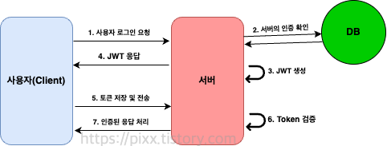
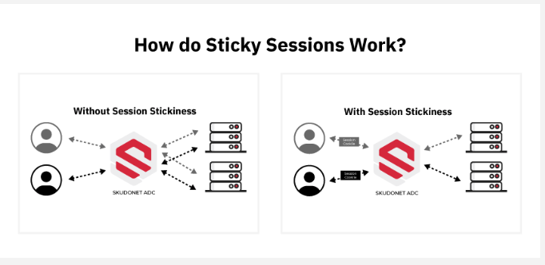
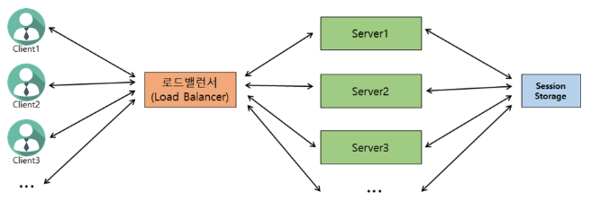
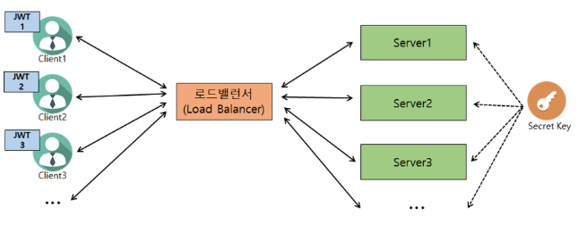

## JWT

- 사용자 인증 및 정보 교환을 위해 사용되는 토큰 기반의 인증 방법
- Json 포맷을 사용
    - Header
        - 토큰의 타입과 사용된 서명 알고리즘을 나타냄
        - 보통 alg(algorithm)과 typ(type) 필드를 포함
            
            ex) *{"alg": "HS256", "typ": "JWT"}*
            
    - Payload
        - 실제 데이터가 담기는 부분
        - Claims라고 불리며 사용자에 대한 정보를 포함
        - 클레임은 등록된 클레임, 공유 클레임, 비공식 클레임으로 나눌 수 있음
    - Signature
        - 헤더와 페이로드를 조합한 후 특정 알고리즘과 비밀키를 사용하여 생성된 서명
        - 토큰의 무결성을 검증하고 변조되지 않았는지 확인
- JWT 토큰 기반 인증
    - 사용자의 인증 정보를 안전하게 전달하고 관리하기 위한 인증 방식
    - 인증 상태를 유지하기 위해 토큰을 사용하며 stateless 인증 방법
    - JWT 토큰을 HTTP 헤더에 실어 서버가 클라이언트를 식별
- JWT 토큰 기반 인증 방식
    
    
    
    1. 사용자 로그인 요청
    2. 서버의 인증 확인
        - 데이터베이스에서 사용자의 이름과 비밀번호를 확인하여 인증을 수행
    3. JWT 생성
        - 인증이 성공하면 서버는 사용자의 정보를 JWT로 암호화하여 생성
    4. JWT 응답
        - 서버는 클라이언트에게 JWT를 포함한 응답을 보냄
    5. 토큰 저장 및 전송
        - 클라이언트는 받은 JWT를 로컬 저장소(local storage | session storage)에 저장하고 이후의 요청마다 JWT를 HTTP 헤더에 담아 서버에 전송
    6. 토큰 검증
        - 서버는 클라이언트의 요청에서 JWT를 추출하고 토큰을 검증하여 유효성을 확인
    7. 인증된 응답 처리
- JWT 사용 이유
    - 서버가 1대인 경우
        - 모든 클라이언트의 로그인 정보 소유
        - 문제점
            - 구조는 간단하지만 확장성이 제한적
            - 서버의 부하가 증가하면 성능 문제가 발생할 수 있음
    - 서버가 2대 이상인 경우
        - 대량의 트래픽 처리를 위해 여러 서버를 운영
        - 문제점
            - 세션 비일관성 : 여러 서버가 존재할 경우 각 서버는 자신의 세션만을 관리하고 있어 서버 간의 세션 데이터 불일치가 발생할 수 있음
                - 해결방법
                - Sticky Session
                    
                    
                    
                    - 클라이언트의 요청을 항상 같은 서버로 라우팅
                    - Cookie를 사용하거나 클라이언트의 IP를 tracking 하는 방식
                    - 서버 장애나 로드 밸런싱에 제한이 있을 수 있음
                - 세션 저장소
                    
                    
                    
                    - 중앙 집중식 세션 저장소를 만들어 모든 서버가 동일한 세션 정보를 접근할 수 있도록 함
                    - Redis, Memcached 등이 이 용도로 사용됨
                    - 장점
                        - 서버 독립성 : 서버 간에 세션을 공유하므로 특정 서버에 의존하지 않고 서버를 추가하거나 제거할 때 유연
                        - 부하 분산 : 로드 밸런서가 요청을 다양한 서버로 분산시킬 수 있음
                        - 세션 복구 : 서버 장애 시에도 세션 정보가 중앙 저장소에 남아있으므로 복구가 용이
                    - 단점
                        - 중앙 집중식 : 세션 저장소에 부하가 집중될 수 있으며 저장소가 장애가 나면 모든 서버의 세션에 영향을 줄 수 있음
                        - 네트워크 지연 : 모든 서버가 중앙 저장소에 접근해야 하므로 네트워크 지연이 있을 수 있음
                - JWT 사용
                    
                    
                    
                    - 로그인 정보를 서버에 저장하지 않고 클라이언트에 JWT를 저장하여 인증/인가를 수행
                    - JWT를 사용하는 시스템에서는 모든 서버가 동일한 비밀 키를 공유해야 함
- JWT 토큰 장단점
    - 장점
        - 동시 접속자가 많을 때 서버 측 부하를 낮출 수 있음
        - 서버 측 상태를 관리하지 않으므로 확장성과 성능이 향상됨
        - 클라이언트와 서버가 다른 도메인일 때 유용
    - 단점
        - 구현 및 관리 복잡도가 증가
        - JWT 안에 정보를 담을 수 있음
            
            → JWT의 크기가 클수록 네트워크 비용 증가
            
        - JWT의 일부분만 만료시키거나 갱신하는 것이 어려움
        - 비밀키 유출 시 보안 문제가 발생할 수 있음