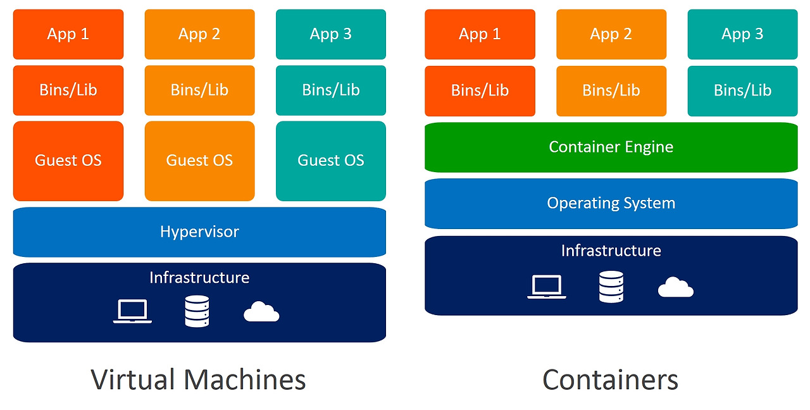

## Docker

- 컨테이너 기반 가상화 플랫폼
    - 컨테이너 : 가상화 기술을 이용하여 어플리케이션과 개발 환경을 격리된 공간에서 실행하는 단위
- 응용 프로그램과 그 종속성을 격리된 환경인 컨테이너로 패키징하여 실행하는 기술
- Docker Compose
    - 여러 개의 도커 컨테이너를 정의하고 실행하기 위한 도구
    - 하나의 설정 파일로 여러 개의 컨테이너를 관리하고 컨테이너 간의 네트워크 및 종속성을 설정하는 데 사용
    
    
    
- 가상머신 vs Docker 컨테이너
    - 가상 머신
        - 호스트 운영체제 위에 가상화된 하드웨어 계층을 생성하고 각 가상 머신은 독립된 운영체제, 커널, 드라이버 등을 가짐
            
            → 무겁고 높은 자원 소비 필요
            
        - 운영체제의 부팅 과정이 필요하므로 시간이 오래 걸림
        - 독립된 운영체제를 가지므로 메모리, 디스크 공간 등 자원을 많이 소비
    - Docker 컨테이너
        - 호스트 운영체제의 커널을 공유하여 가볍게 격리된 환경을 생성
        - 가상 머신보다 더 가벼우며 효율적으로 실행
        - 이미지와 컨테이너 레이어를 사용하여 빠르게 생성되며 실행 속도가 매우 빠름
        - 컨테이너는 호스트 운영체제의 커널을 공유하므로 가볍고 효율적으로 자원을 활용
- Docker 사용 이유
    - 환경 일치성 : 다양한 환경에서 동일한 실행 환경을 보장
    - 편리한 배포 : 도커 컨테이너는 이미지로 패키징되어 배포되므로 어플리케이션 배포가 간단해짐
    - 격리된 환경 : 각 컨테이너를 격리된 환경으로 실행하므로 하나의 컨테이너에서 발생한 문제가 다른 컨테이너에 영향을 주지 않음
    - 자원 효율성 : 가상 머신과 비교해 더 가볍고 빠르며, 호스트 시스템의 리소스를 효율적으로 활용할 수 있음
    - 스케일링 : 컨테이너 기반 아키텍처는 쉬운 스케일링이 가능하여 요구에 따라 응용 프로그램을 확장할 수 있음
- Docker 사용 방법
    - 도커 이미지 빌드
        - Dockerfile을 작성하여 도커 이미지를 생성
        - 이미지는 컨테이너 실행 환경을 정의하는데 사용됨
    - 도커 컨테이너 실행
        - 이미지를 기반으로 도커 컨테이너를 실행
        - 컨테이너는 격리된 환경에서 실행되므로 각각의 컨테이너는 독립적으로 동작
    - 컨테이너 네트워킹
        - 컨테이너 간 통신 또는 컨테이너와 외부 네트워크 간의 통신을 관리하는 기능